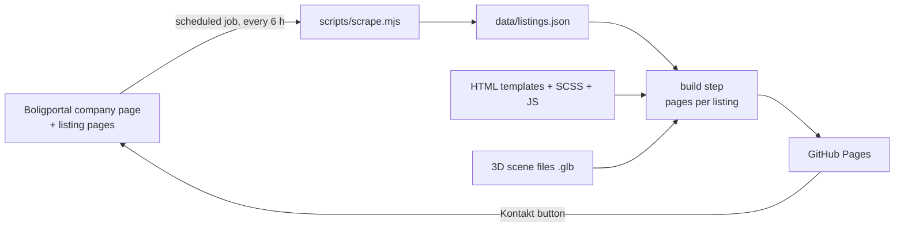

# Rent Herning website: build plan

*Draft 1 · 1 November 2026 · Philip Lau*

## Goal and scope

The new rentherning.dk replaces the 2021 template site. It works equally well on a phone, a laptop and a large screen, keeps Rent Herning's existing logo and colours, and adds three things the old site lacks. The first is an animated 3D cut-out of Herning on the home page. The second is a listings section built from Rent Herning's own adverts on Boligportal, with cards and in-site detail pages. The third is a guided help and contact journey that works for tenants who are not comfortable with technology. A DA/EN switch sits in the header.

The first milestone is a demo on GitHub Pages (repo `RentHerning/website`, made public) that the CEO can click through. Permanent hosting is decided after that, so the demo is built in a way that can move to a PHP host without a redesign.

## How the pieces fit together

GitHub Pages only serves static files, so the work PHP would normally do on request happens ahead of time in GitHub Actions instead. A scheduled job reads the listings from Boligportal, saves them as a data file, rebuilds the site and publishes it.

## Listings data

Boligportal's company page for Rent Herning (`/cp/rentherning/`) has every active listing built into the page as structured data, so the job does not need to read the visible page. Each listing page (`/…-id-<id>`) adds the full description. The job therefore fetches the company page, reads the listing IDs, then fetches each listing page. Today that is eight requests in total.

| Field on the site | Source field | Used on |
|---|---|---|
| Image | `images[0].url` with `?w=…&h=…&fit=crop` | Card, gallery on detail page |
| Size, rooms | `size_m2`, `rooms` | Card, detail page |
| Location | `street_name`, `city_area` or `city`, `postal_code` | Card, detail page |
| Monthly rent | `monthly_rent` (+ `monthly_rent_extra_costs` as á conto) | Card, detail page |
| Deposit, prepaid rent | `deposit`, `prepaid_rent` | Detail page |
| Move-in date, floor, energy label | `available_from`, `floor`, `energy_rating` | Detail page |
| Features | `features.*` (balcony, pets, parking …) | Detail page as icons |
| Map pin | `location.lat`, `location.lng` | Detail page, 3D scene |
| Contact | `https://www.boligportal.dk` + `url` | "Kontakt via Boligportal" button |

The first version uses plain HTTP requests and reads the embedded data. Playwright is kept as a fallback in case Boligportal starts blocking plain requests. The job commits `data/listings.json` only when something has changed, and listings that disappear are removed from the site on the next run. Images are linked from Boligportal's image server, not copied. Before the site goes live on its real domain, Rent Herning should confirm with Boligportal that showing its own adverts this way is fine, or ask for an official export.

## Pages

| Page | Content |
|---|---|
| Forside (home) | 3D Herning hero, short value statement, the newest available homes (cards), "Bor du hos os?" entry to help, about Rent Herning |
| Ledige boliger | Card grid of all listings: 3 columns on large screens, 2 on tablets, 1 on phones, with a simple type filter (lejlighed, hus, rækkehus) |
| Bolig detail (`/bolig/<id>/`) | Gallery, key facts table, description, features, small map, and a sticky "Kontakt via Boligportal" button. One static page per listing, generated by the build so links can be shared |
| Hjælp & kontakt | Guided flow (below) |
| Husorden, Privatlivspolitik | The two PDFs, with a short readable summary on the page |

## Guided help and contact

The current five-item Kontakt dropdown assumes people know which form they need. The new page asks one plain question, "Hvad kan vi hjælpe med?", and offers large buttons with icons: something is broken right now (akut), a caretaker task (vicevært), the 14-day inspection after moving in, moving out (opsigelse), and other questions. "Akut" always shows the emergency phone number first, before any form. Every other route is a short form with one question per step, plain language, big touch targets and a clear confirmation at the end. In the demo, the final submit goes to a form service such as Formspree. On real hosting it becomes a PHP mail handler. Later on, Rita can open the same flow with the answers already filled in. The emergency number and the receiving email address are placeholders until the CEO provides them.

## 3D Herning on the home page

Two versions are built so the CEO can choose by looking at them. Both use Three.js and share the same camera, lighting, slow orbit animation and listing pins.

| | A: Stylised town | B: Real Herning cut-out |
|---|---|---|
| Look | Invented low-poly blocks in Rent Herning's colours, like the isometric reference image | Real building outlines and streets of the city centre from OpenStreetMap, raised to approximate heights |
| Recognisable to locals | No | Yes (streets, Fermaten/station area, the centre) |
| Build effort | Lower | Higher (data cleanup, simplifying) |
| Extra requirement | None | "© OpenStreetMap contributors" credit on the page |

Performance is designed in from the start. The geometry is generated once at build time and saved as a single compressed `.glb` file, with a budget of under 1.5 MB. Buildings share one material and are merged into a few draw calls. Lighting is baked into vertex colours with a single soft shadow. The animation pauses when the hero is off-screen or the tab is hidden. Visitors with "reduced motion" turned on, and very weak devices, get a still rendered image of the same scene. Text and buttons in the hero never wait for the 3D scene to load.

## Look, readability and language

The logo, favicon icons, SVG icons and colour values are taken from the current rentherning.dk and turned into SCSS variables. Typography follows the readability guidance shared at the start: body text at 16–18 px, line height around 1.5, line length kept to about 60–75 characters, and colour contrast that meets WCAG AA. The DA/EN switch in the header changes the interface text. Listing titles and descriptions stay in Danish, because Boligportal only holds them in Danish.

## Tech and repo layout

Plain HTML, SCSS and JavaScript. A small Node build script (esbuild for the JavaScript, Dart Sass for the styles) renders the page templates for both languages; Vite was dropped because generating one page per listing and per language is simpler without it. When the site moves to a PHP host, the templates can become PHP includes and the listings job can stay as it is.

| Path | Purpose |
|---|---|
| `src/` | Page templates, `scss/`, `js/` |
| `src/js/city/` | Three.js scene, loaders, pins |
| `scripts/scrape.mjs` | Reads listings from Boligportal into `data/listings.json` |
| `build/build.mjs`, `build/dev.mjs` | Renders all pages (incl. `/bolig/<id>/`), compiles SCSS, bundles JS; dev server with live reload |
| `scripts/city/` | One-off scripts that make the two `.glb` scenes |
| `public/` | Logo, icons, PDFs, generated `.glb` files |
| `.github/workflows/` | Scheduled listings refresh and deploy to Pages |

## Order of work

| Step | Work | Result |
|---|---|---|
| 1 | Repo setup, build script, SCSS structure, brand assets taken from the current site | Empty site with header, footer, DA/EN switch |
| 2 | Listings job and data file, GitHub Action | `listings.json` refreshes automatically |
| 3 | Listing cards, Ledige boliger page, detail pages | Listings browsable inside the site |
| 4 | Home page layout with a placeholder hero | Full page flow clickable |
| 5 | 3D scene A, then scene B, with a switch to compare | Two hero versions for the CEO |
| 6 | Guided help and contact flow | Tenant journey works end to end |
| 7 | Checks: phone, tablet, laptop and 4K widths, Lighthouse, keyboard and screen reader basics | Demo published on GitHub Pages |

## Open items

The CEO will provide the emergency phone number and the email address that should receive the forms. Rent Herning should get confirmation from Boligportal before the site goes live on its real domain. The choice between 3D versions A and B, and the permanent hosting, are decided after the demo.
